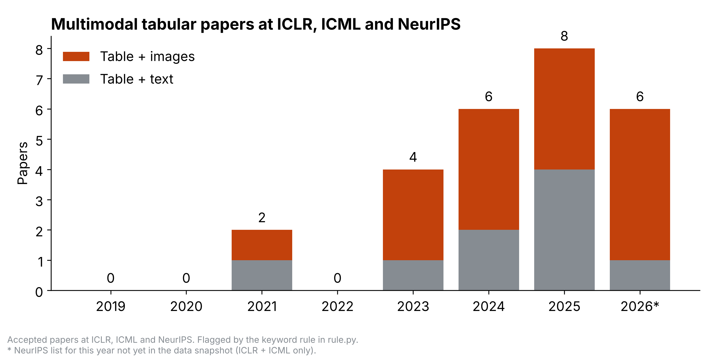
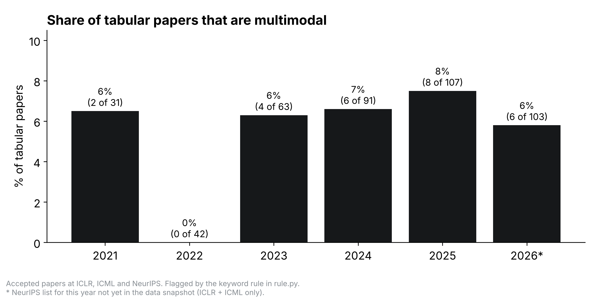

# Multimodal tabular papers at ICLR, ICML and NeurIPS

How many accepted papers at the three main ML conferences learn from **tables together with images or text**, and is that growing?

Everything is computed from scratch from public data: download the paper lists, run a keyword rule over every title and abstract, count, plot.




## Run it

```bash
pip install -r requirements.txt
python download.py   # ~600 MB of paper lists into data/ (a few minutes, only the first time)
python count.py      # runs the rule, writes results/*.csv
python plot.py       # writes results/*.png
```

Same data snapshot + same code = same numbers. Python 3.8+.

## Files

| File | What it does |
|---|---|
| `download.py` | Downloads one JSON file per conference per year from [Paper Copilot's paperlists](https://github.com/papercopilot/paperlists), pinned to commit `9fcfd12` (30 June 2026). |
| `rule.py` | The keyword rule. `classify(title, abstract)` says whether a paper is image + table and/or text + table. |
| `count.py` | Keeps accepted papers (2019–2026), applies the rule, writes `results/counts_by_year.csv` and `results/flagged_papers.csv`. |
| `plot.py` | Draws the two plots from `results/counts_by_year.csv`. |
| `test_rule.py` | Example sentences the rule must get right. Run `python test_rule.py`. |

## What counts

- **Image + table**: the same samples have images (photos, MRI/CT/X-ray, histopathology, satellite images) and tabular data (tables, EHR, clinical variables). Example: cardiac MRI + patient measurements.
- **Text + table**: tables whose cells contain text (text fields, string columns, free-text), or structured records paired with text (EHR + clinical notes).
- **Not counted**: tables shown as images (screenshots, charts), table question answering, text-to-SQL, papers that merely test on image and tabular datasets separately, and "tabular" in the reinforcement-learning sense ("tabular MDP").

## How the rule works

The abstract is split into sentences.

- A paper is **image + table** if one sentence mentions image data and tabular data and the paper calls itself multimodal (multimodal, cross-modal, modalities, fusion, paired). A hyphenated "image-tabular" or "vision-tabular" is enough on its own.
- A paper is **text + table** if one sentence mentions text inside a table ("text fields", "string columns", "free-text", "numerical, categorical and text features"), or pairs tabular data with text, notes or reports in a clearly multimodal paper.
- A sentence is ignored when it is a contrast ("unlike images and text, tabular data…"), a list of evaluation domains ("on image, text and tabular benchmarks"), or about documents, charts or turning tables into text.

The denominator in the second plot ("tabular papers") is every accepted paper that uses the word "tabular" for data, excluding reinforcement-learning papers.

## How accurate is the rule?

Checked once by hand while designing the rule (not part of the code):

- **Precision ≈ 96–100%.** Almost every flagged paper really is multimodal tabular.
- **Recall ≈ 60%.** About 40% are missed, mostly papers that call their table "metadata" or "covariates" rather than tabular / EHR / clinical data.

So read the plotted numbers as a **lower bound** with a reliable trend. Hand-screening every candidate found about 1.6× as many papers per year, with the same shape over time.

## Caveats

- 2026 has ICLR and ICML only: NeurIPS 2026 is not in the pinned snapshot (marked `*`). To update, change `SNAPSHOT` in `download.py` to a newer paperlists commit, delete `data/`, and rerun.
- Only these three conferences. Much image + table work appears at CVPR, ECCV and MICCAI.
- Only titles and abstracts are read, not full papers.

## Data

Paper lists by [Paper Copilot](https://github.com/papercopilot/paperlists). Accepted means a decision of Poster, Oral, Spotlight, Talk, Top-5%, Top-25%, Accept, or ICLR 2026 conditional acceptance.
